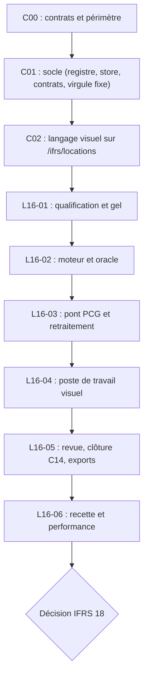
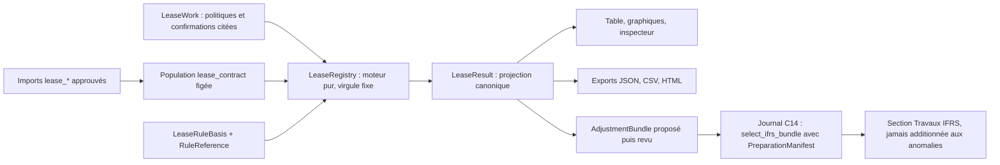

# Contrat commun — atelier « Locations IFRS 16 » (lot C00)

Version 1.0 du 29/10/2026, inspectée sur `main` `97bed70`. Ce document **fixe** les noms, contrats et conventions que C01, C02 et L16-01 → L16-06 implémentent. Les noms décidés ici restent stables : un changement exige une décision écrite dans le handoff du lot qui la prend.

- Périmètre : [`SCOPE_V1.md`](./SCOPE_V1.md). Sources : [`SOURCES.md`](./SOURCES.md). Attendus : [`RECETTE_REFERENCE.md`](./RECETTE_REFERENCE.md).
- Aucun code applicatif, aucune migration, aucune dépendance n'est ajoutée par C00.
- Les décisions portent un identifiant `Dnn`, repris dans [`handoffs/C00.md`](./handoffs/C00.md).

## 1. Carte d'impact : réutiliser, étendre, créer

Le patron de référence est la feuille Emprunts (`loans.review`, mission C13) : moteur pur, adaptateur de calcul, runtime sur le store partagé « clients », commandes HTTP idempotentes, export à version exacte. L'atelier Locations le reproduit sans l'appeler : la sémantique des emprunts n'est pas celle d'IFRS 16 et le moteur Emprunts exclut le crédit-bail (`LOAN_EXCLUSIONS.credit_bail`, `lib/workpapers/loan-rules.ts`).

| Composant existant | Décision | Ce qui change |
|---|---|---|
| `WorkpaperService` (`lib/workpapers/service.ts`) | **Étendre** | Méthode `configureLeases`, branche `execute` qui fusionne les preuves du résultat. `ifrs16.leases` ajouté aux **trois** listes `realAdapter` : type du constructeur, liste de `actor()`, liste de `lock()` |
| `WorkpaperRun`, `validateRun`, `contentHash` (`model.ts`) | **Étendre** | Champ `leaseWork` (`ifrs16-leases-1`), contrôle dans `validateRun`, inclusion dans `contentHash`, remise à zéro dans `revise()` en mode réel. Unité de population `lease_contract` |
| `RuleReference` (`model.ts:44`) | **Réutiliser tel quel** | Voir D03 : aucune nouvelle valeur d'`authority` |
| `CalculationRegistry` (`calculations.ts`) | **Réutiliser** | `LeaseRegistry extends CalculationRegistry`, sur le modèle de `LoanRegistry` |
| `Money`, `KnownAmount`, `cents`, `money` (`lib/canonical-model/money.ts`) | **Réutiliser** | Frontière monétaire inchangée |
| `AccountingPeriod` (`period.ts`) | **Réutiliser** | `asOfDate` sert de date de revue pour les échéances exigibles |
| Imports, approbation, têtes de source (`imports.ts`, `clients-runtime.ts`) | **Étendre** | Types de documents `lease_*` (D10), ajoutés à la porte de `previewImport` ; schéma de colonnes fermé par type, dans `lease-sources.ts` |
| Population, sélection (`selection.ts`) | **Réutiliser** | Population figée et hachée ; unité `lease_contract` |
| Store « clients » (`clients-persistence.ts`, tables `clients_*`) | **Réutiliser** | `ifrs16.leases` ajouté à la liste blanche des gabarits ; migration additive `0022` sur la contrainte `document_type` (D05) |
| Registre des capacités (`lib/capabilities/*`) | **Étendre** | Nouvel axe « référentiel », hors cycles du journal (D04) |
| Dossier de clôture C14 (`closing-*.ts`) | **Étendre (L16-05)** | Section « Travaux IFRS » à part, jamais additionnée aux anomalies ni aux effets C05 ; commandes de sélection du retraitement (D15) |
| Adaptateurs de fraîcheur (`closing-adapters.ts`) | **Étendre** | Règle `PROCEDURE_RULES["ifrs16.leases"]` : source remplacée **ou ajoutée** après le gel, comme Emprunts |
| Relecture personnelle nommée (`approvalKind`, `review-kind.ts`) | **Réutiliser** | Aucune seconde identité fictive |
| Moteur Immobilisations (`fixed-assets.ts`) | **Non réutilisé** | Annuité PCG avec prorata déclaré, rattachée à `fixed_assets.review` par `assertFixedAssetsContext`. L'amortissement du droit d'utilisation (cumul arrondi en mois entiers) est une fonction propre de quelques lignes ; aucun droit d'utilisation n'entre dans le registre des immobilisations PCG |
| Moteur Emprunts (`loan-review.ts`, `ratePpm`) | **Non réutilisé** | Taux à 6 décimales et intérêts au jour : insuffisant pour `(1 + r)^(1/12)` |
| Base de connaissance (`data/sources/ifrs.yml`, `data/ifrs/standards.yml`) | **Étendre (L16-02)** | Entrées des décisions IFRIC lues et statut d'IFRS 16 (D07) |
| Registre du référentiel (`lib/referentiel/sources.ts`) | **Non pertinent** | Il n'est pas modifié, donc pas de nouvelle édition (D07) |
| Châssis du tableau de bord (`components/instruments/*`) | **Non pertinent pour la feuille** | La feuille est une route autonome (D22) |
| Recharts, TanStack Table | **Réutiliser** | Aucune nouvelle bibliothèque graphique |
| Ordonnanceur de jobs | **Ne pas créer en C01** | Calcul synchrone mesuré en L16-02 ; un job local n'est créé que si le budget mesuré est dépassé |

## 2. Décisions sur les points ouverts du relevé d'écarts

| ID | Point (`ECARTS_e25a4ad_97bed70.md`) | Décision |
|---|---|---|
| D01 | Périmètre de C00 | IFRS 16 seul, avec le minimum de contrats communs. Les objets propres à IFRS 18 (`PresentationDataset`, comparatifs, MPM) sont réservés (§ 12) |
| D02 | Arithmétique décimale (§ 4.1) | **Virgule fixe interne sur `bigint`, échelle 10⁴⁰**, sans dépendance (§ 5.1). `decimal.js` est écarté : il ajouterait une dépendance pour trois opérations, alors que l'oracle Python indépendant couvre le risque d'erreur d'implémentation |
| D03 | Autorité de la règle (§ 4.2) | `RuleReference` reste inchangée. Comme toutes les feuilles existantes, la règle a `authority: "internal"` et `source: "docs/ifrs/CONTRAT_COMMUN.md"` : c'est l'implémentation par PROBANT d'un contrat écrit. `effectiveFrom: "2019-01-01"` (IFRS 16 C1). `validation: "provisional"` vaut `review_required` : l'exécution réelle est bloquée par `calculations.ts` (`rule_not_applicable`) tant que la fiche de règle n'est pas `validated`. La base normative (juridiction, édition, paragraphes) vit dans `LeaseRuleBasis` (§ 4.4) et dans la base de connaissance, dont les niveaux d'autorité existants suffisent (`international_standard`, juridictions `IASB` / `EU`). Le sens de `law` n'est pas élargi |
| D04 | Rattachement au registre (§ 4.3) | **Axe distinct « référentiel »**, pas un cycle du journal. Rattacher `ifrs16.leases` à `dettes_financieres` ou à `immobilisations` aurait trois effets indésirables : `CapabilityAccess` déclarerait tout le cycle « incomplète ou désactivée » quand IFRS 16 n'est pas activé ; la ligne du cycle compterait l'état des retraitements IFRS ; le dossier de clôture rangerait la feuille dans ce cycle avec ses exclusions. Ajouter un 15e cycle casserait les listes fermées (`PRESENTATION`, sélecteurs de clôture, tests à 14 cycles) et placerait « IFRS » parmi les cycles du journal. Détail au § 9 |
| D05 | Stockage | **Store « clients »**, comme Emprunts : aucune nouvelle table. Migration additive `drizzle/0022_ifrs16_leases` qui élargit `clients_imports_document_type_check` aux types `lease_*`. Le `down` refuse le retour en arrière si une donnée `lease_*` ou une version `ifrs16.leases` existe, sur le modèle de `0021` |
| D06 | Recouvrements de contrats (§ 4.4) | Voir § 4 : snapshot, projection et règle réutilisent l'existant. Seuls `PreparationManifest`, `AdjustmentBundle` et `LeaseRuleBasis` sont créés |
| D07 | Éditions du référentiel (§ 4.5) | Les sources IFRS restent dans la base de connaissance (`data/sources/ifrs.yml`, `data/ifrs/standards.yml`) et ne sont pas ajoutées à `lib/referentiel/sources.ts`. Si un lot les y ajoute un jour, l'édition suivante est obligatoire. Mettre à jour la base de connaissance impose de tenir à jour `docs/knowledge/REVIEW_REQUIRED.md`, que lit `lib/knowledge/__tests__/validation.test.ts` |
| D08 | Référence UE d'IFRS 18 (§ 4.6) | Non vérifiée, réservée au lot IFRS 18. Pour IFRS 16, le texte UE (règlement 2023/1803) n'a pas pu être lu (EUR-Lex inaccessible le 29/10) : la juridiction `EU_adopted` reste non activable en réel (X33) |
| D09 | Base d'entrée d'IFRS 18 (§ 4.7) | Décision d'engager IFRS 18 reportée après L16-06 |
| D22 | Placement de l'interface (§ 3) | Voir § 10 |

## 3. Noms stables (D10)

| Objet | Nom |
|---|---|
| Procédure, règle, gabarit | `ifrs16.leases` ; version de règle et de gabarit `1.0.0` au lot L16-02 |
| Page | `/ifrs/locations` (l'IFRS 18 éventuel prendra `/ifrs/presentation`) |
| API | `/api/workpapers/locations-ifrs16`, avec `/imports`, `/export` et `/demo` (synthétique), comme `/api/workpapers/emprunts` |
| Travail de la feuille | `WorkpaperRun.leaseWork`, `schemaVersion: "ifrs16-leases-1"` |
| Résultat | `schemaVersion: "ifrs16-result-2"` (format compact depuis le 31/10/2026 ; `ifrs16-result-1` n’a jamais été stocké en réel) |
| Retraitement | `schemaVersion: "ifrs-bundle-1"`, `kind: "closing_adjustment"` |
| Unité de population | `lease_contract` : un contrat qualifié par lignée |
| Types de documents | `lease_contracts` (contrats et versions), `lease_assumptions` (taux, durée, exemptions, réponses de périmètre), `lease_schedule` (échéances et règlements), `lease_ledger` (lignes 612 / 613 / 614 et pièces), `lease_opening` (ouverture historique). Requis au gel : les trois premiers. `lease_ledger` est requis pour un retraitement déterminé, `lease_opening` pour une reprise historique |
| Drapeau d'activation | `PROBANT_IFRS16_DURABLE` (`PROCEDURE_ACTIVATION`, `.env.example`, `scripts/local/local-lib.mjs`), `disabled` par défaut |
| Préfixe des codes d'erreur | `L16_` |
| Comptes logiques du retraitement | `rou_gross`, `rou_accumulated_depreciation`, `lease_liability`, `lease_interest_expense`, `rou_depreciation_expense`, `pcg_rent_neutralized`, `opening_equity_effect`. Ce sont des codes internes, pas des comptes PCG ; le mapping vers un plan de reporting est approuvé et sourcé en L16-03 |
| Identité économique d'un contrat | `ifrs16:lease:<contractId>`, clé de déduplication des retraitements |
| Code | `lib/ifrs/shared/` (virgule fixe, contexte, manifeste, retraitement) ; `lib/ifrs/leases/` (moteur pur, fiche de règle) ; `lib/workpapers/lease-*.ts` (adaptateur, runtime, HTTP, commandes, sources, export, serveur) ; `components/probant/ifrs/` (D24) |

## 4. Contrats de données

### 4.1 `IfrsContext` — créé, minimal

```ts
interface IfrsContext {
  scope: WorkpaperScope;            // organizationId, dossierId, periodId, mode "demo" | "real"
  period: AccountingPeriod;         // startDate, closingDate, asOfDate (date de revue), EUR
  framework: { standard: "IFRS 16"; jurisdiction: "IASB" | "EU_adopted"; edition: string; editionFingerprint: string | null };
  firstApplication: { kind: "not_applicable"; reason: string };  // aucune méthode de transition choisie en V1
}
```

`mode: "demo"` correspond au scénario synthétique (« simulation non revue ») et `mode: "real"` au dossier local persistant. Un contexte refusé ne laisse aucune écriture partielle (`WORKPAPER_SCOPE_MISMATCH`, `WORKPAPER_PERIOD_INVALID`).

### 4.2 Snapshot des sources — réutilisé

Il n'y a pas de type `SourceSnapshot`. Le snapshot d'une feuille, c'est `importIds` plus la `Population` et la `SelectionSet` figées et hachées, plus les `sourceRefs` du `CalculationRun` : document logique, version, empreinte, version du parseur et du mapping.

### 4.3 `PreparationManifest` — créé, minimal

Il décrit la base cible d'une sélection de retraitement (§ 7). Il ne certifie pas l'ensemble des IFRS de l'entité.

```ts
interface PreparationManifest {
  baseKind: "PCG" | "IFRS_prepared" | "partial_bridge";
  sourceRefs: { importId: string; documentVersionId: string; sha256: string }[];   // grand livre ou reporting visé
  period: { startDate: string; closingDate: string };
  includedAdjustments: { kind: "declared"; identities: string[] } | { kind: "unknown"; reason: string };
  declaredBy: string; declaredAt: string;   // identité serveur, jamais le navigateur
  limits: string; citation: NoteCitation;
}
```

En V1, la base cible est le grand livre PCG du dossier : `baseKind: "PCG"`. `includedAdjustments` de type `unknown` bloque la sélection (X29). Une base PCG plus le seul retraitement IFRS 16 reste un `partial_bridge` : jamais une base IFRS complète.

### 4.4 Règle — `RuleReference` réutilisée et `LeaseRuleBasis` créée

```ts
const IFRS16_RULE: RuleReference = { id: "ifrs16.leases", version: "1.0.0", authority: "internal",
  source: "docs/ifrs/CONTRAT_COMMUN.md", effectiveFrom: "2019-01-01", validation: "provisional" };

interface LeaseRuleBasis {   // fiche de règle (plan 03 § 4), une par version de règle
  ruleId: "ifrs16.leases"; ruleVersion: string; engineVersion: string;
  jurisdiction: "IASB" | "EU_adopted"; standardEdition: string;
  paragraphs: string[];                      // ex. "§ 26", "B34"
  sourceIds: string[];                       // identifiants de la base de connaissance
  consultedAt: string; effectiveDate: string; entityProfile: string;
  assumptions: string[]; internalPolicies: string[];   // conventions internes (§ 5), séparées des exigences
  status: "review_required" | "validated"; reviewedBy?: string; reviewedAt?: string;
  referenceCases: string[]; exclusions: string[];      // identifiants des fixtures et des cas Xnn
}
```

`validation: "validated"` n'est posé qu'avec une fiche `validated` relue et nommée. Valider la règle n'est pas valider un dossier (plan 03 § 4).

### 4.5 `LeaseWork` — créé (L16-01)

C'est le travail horodaté par le serveur, comme `loanWork` : `schemaVersion`, `authorId` et `authoredAt` sont posés par le serveur, et aucun rôle n'est accepté du navigateur. Il contient :
- les **politiques** : exemption court terme par catégorie d'actif, élection § 15 par catégorie, traitement de la TVA ;
- pour chaque contrat, les **confirmations humaines** des réponses importées. Chaque jugement est une réponse accompagnée d'une `NoteCitation` (pièce, version, ligne), résolue par le serveur à partir des sources figées.

Le dictionnaire exact des champs relève de L16-01. Invariant : **vide ≠ zéro ≠ non applicable**, et un champ de périmètre vide donne `a_qualifier` (X25).

### 4.6 `LeaseResult` — la projection canonique

Résultat unique lu par la table, les graphiques, la revue et l'export. Aucun montant n'est recalculé dans React.

```ts
interface LeaseResult {
  schemaVersion: "ifrs16-result-2"; runId: string; scope: WorkpaperScope; period: AccountingPeriod;
  rule: { id: string; version: string; basisStatus: "review_required" | "validated" }; engineVersion: string;
  arithmetic: { scale: 40; rounding: "half_away_from_zero_cent"; publication: "rounded_balances" };
  contracts: {
    contractId: string; version: string; status: "non_location" | "exemption_documentee" | "eligible_v1" | "a_qualifier" | "hors_scope_v1";
    reasons: string[];              // identifiants Xnn et messages
    fingerprint: string;            // contrat + politique + règle : sert à comparer deux versions
    exact?: { monthlyRate: string; debtInitial: string };   // 40 décimales, en chaîne
    dues: { count: number; payable: number };  // détail des échéances relu sur les sources figées (qualification)
    schedule?: ScheduleColumns;     // échéancier publié du moteur, en colonnes (t, dueDate, payment, openingDebt, interest, …)
    closing?: ClosingFigures;       // même structure que l'oracle (RECETTE_REFERENCE § 3)
    result: "computed" | "diagnostic" | "not_commenced" | "not_applicable";
  }[];
  portfolio: { byStatus: Record<string, number>; computedSubtotal: ClosingFigures | null; blockedIds: string[] };  // le sous-total porte « contrats calculés »
  ledgerFraming: { matched: number; unmatched: number; absMatched: Money; absUnmatched: Money; differences: KnownAmount[] };
  bundle: AdjustmentBundle | null;  // L16-03 ; null si un contrat calculé n'est pas cadré
  limitations: string[];
  evidence: { purpose: string; documents: { documentVersionId: string; rows: { rowId: string; row: number | null }[] }[] };  // preuves ligne à ligne, par pièce
  outcome: "no_exception_detected" | "exceptions_detected" | "inconclusive";
}
```

**Format compact (31/10/2026, `CAPACITE_LOCATIONS.md`, options O1 et O2).** Chaque version de la feuille recopie le calcul entier : le résultat ne garde donc que ce que les sources figées ne redonnent pas.
- **Échéances** : seulement comptées dans le résultat.
- **Échéancier** : écrit en colonnes.
- **Preuves** : regroupées par pièce, en gardant chaque ligne. Une preuve de ligne garde l'identifiant `runId:lease:rowId` que citent les écritures du retraitement.
- **Feuille** : le service y ajoute une preuve vérifiée par pièce citée (`leaseRunEvidence`), sans recopier le détail ligne à ligne.
- **Entrées du calcul** : `result.input` garde, par source, son nombre de lignes et son empreinte au lieu des lignes. `inputHash` se revérifie en reconstituant les entrées depuis les sources figées (`leaseCalculationInput`), et une source altérée est refusée (`L16_INPUT_SOURCE_MISMATCH`).

**Classement du résultat.** Un retraitement normal **n'est pas** une exception d'audit.
- `inconclusive` : au moins un contrat de la population est `a_qualifier` ou en `diagnostic`.
- `exceptions_detected` : un écart **connu** de cadrage (charge PCG face à l'échéancier, ou ouverture externe face au recalcul) est différent de zéro.
- Sinon : `no_exception_detected`.

### 4.7 `AdjustmentBundle` — créé (L16-03)

```ts
interface AdjustmentBundle {
  schemaVersion: "ifrs-bundle-1"; kind: "closing_adjustment";
  logicalId: string;        // `ifrs16.leases:${rootId}` : la lignée de la feuille
  revision: number; runId: string; runVersion: number; contentHash: string; bundleHash: string;
  scope: WorkpaperScope; period: { startDate: string; closingDate: string };
  expectedBase: { baseKind: "PCG"; sourceRefs: PreparationManifest["sourceRefs"] };
  identities: string[];     // `ifrs16:lease:<contractId>`, triées, sans doublon
  lines: { account: LogicalAccount; side: "debit" | "credit"; amount: Money; contractId: string; contractVersion: string;
           nature: "recognition" | "interest" | "depreciation" | "rent_neutralization" | "opening_effect";
           evidence: string[] }[];
  resultContributions: { contractId: string; nature: "lease_interest_expense" | "rou_depreciation_expense" | "pcg_rent_neutralized"; amount: Money }[];
  taxStatus: "not_computed";
  status: "proposed" | "reviewed";   // « sélectionné » vit dans le journal de clôture (§ 7) ; « comptabilisé » exige une preuve distincte, hors V1
}
```

**Invariants**
- Débit = crédit au centime, par contrat et au total. L'équilibre ne prouve pas la pertinence.
- Aucune ligne de trésorerie : le décaissement est déjà dans la base PCG.
- Aucune écriture dans le FEC source.
- Un même `logicalId` + révision avec un contenu différent est rejeté (`L16_BUNDLE_CONTENT_CONFLICT`). Un rejeu identique ne double rien.
- `resultContributions` est signée : produit positif, charge négative. La nature y reste explicite, pour qu'un classement IFRS 18 ultérieur reste possible. IFRS 16 § 49, modifié par IFRS 18 (C1E), renvoie la charge d'intérêts à IFRS 18 § 61 : à relire dans le lot IFRS 18.

## 5. Conventions de calcul

### 5.1 Virgule fixe (D02)

- Valeurs économiques en `bigint` à l'échelle 10⁴⁰ (40 décimales). Le plan proposait « 40 chiffres significatifs » : en virgule fixe, cela donne plus de chiffres pour les montants et au moins 39 pour un facteur d'actualisation supérieur à 0,07. Convention interne.
- Opérations : addition et soustraction exactes. Multiplication et division arrondies à l'échelle, moitié à l'opposé de zéro. Racine 12e : `floor((10⁴⁰ + r·10⁴⁰) × 10^(40×11))^(1/12)` par Newton entier. Taux mensuel = racine − 10⁴⁰.
- Pas de `number` dans le chemin monétaire. Pas de `bigint` sérialisé directement en JSON : les valeurs sortent en chaînes. Pas de chaîne vide convertie en zéro.
- Entrée du taux : chaîne décimale de fraction, au plus 30 décimales, 0 ≤ r ≤ 1. Distincte de `Money` et du `ratePpm` des emprunts.
- **Critère de précision interne, fixé avant tout calcul** : écart absolu ≤ 10⁻²⁰ € entre moteur et oracle sur toute valeur économique exacte des fixtures. Les valeurs publiées doivent être égales au centime.

### 5.2 Échéancier et publication (D12)

- Taux mensuel `i = (1 + r)^(1/12) − 1`. **`r / 12` est interdit** pour un taux effectif. Pour `r = 0`, aucune division : la dette est la somme des loyers.
- Dette exacte : `D0 = Σ L / (1 + i)^t`, puis `D_t = D_(t−1) × (1 + i) − L_t`.
- Publication des **soldes** au centime. Intérêt publié = dette publiée de clôture − dette publiée d'ouverture + loyers de la période ; principal = loyers − intérêt publié.
- L'écart entre intérêt publié et intérêt économique arrondi est tracé par mois, borné à 1 centime. Aucun centime n'est caché dans une dernière échéance ni dans un compte « divers ». Un résidu inexpliqué n'est jamais forcé à zéro.
- Droit d'utilisation : `ROU0` = dette initiale publiée. Cumul publié après `j` mois = arrondi(`ROU0 × j / m`), avec `m` = min(durée d'utilité, durée du contrat). Dotation = différence de cumuls : jamais au-delà de la base, jamais de valeur nette négative.

### 5.3 Signes (D11)

| Objet | Convention |
|---|---|
| Lignes du retraitement | `side` débit ou crédit, montant toujours positif, équilibre exact en centimes |
| Contributions au résultat | Produit positif, charge négative |
| Dette locative | Encours positif. Principal, intérêts, paiements et flux non actualisés restent distincts |
| Effet d'ouverture | ROU net d'ouverture − dette d'ouverture : négatif = diminution des capitaux propres (ligne au débit) |

### 5.4 Taux effectif et taux nominal (D13)

Seul le taux annuel effectif entre dans le moteur. Un taux nominal (ou mensuel) fourni par la source est `a_qualifier` (X19), tant que l'utilisateur n'a pas saisi le taux effectif converti en citant la source nominale et la méthode de conversion. L'outil ne convertit jamais en silence. Un taux de zéro documenté est admis ; un taux négatif est hors V1.

### 5.5 Reprise historique (D14)

Un contrat commencé avant la période est recalculé depuis son origine. Il ne devient `computed` que si l'ouverture `lease_opening` (dette, ROU brut / cumul / net, date, référence du reporting IFRS validé, preuve de revue) est égale au centime au recalcul. Sinon il est en `diagnostic` (X24). Une ouverture externe n'est jamais retenue pour équilibrer un calcul, et l'outil ne choisit aucune méthode de transition (X32). Les retraitements des exercices antérieurs passent par l'effet d'ouverture, jamais par une charge de N (fixture F08).

## 6. Versions, invalidation, revue

| Sujet | Décision |
|---|---|
| États (D16) | Les états de feuille existants sont réutilisés. Exécution (`result.execution`), résultat de contrôle (`result.outcome`), conclusion humaine et relecture (`approval`) restent quatre dimensions. Aucun nouvel état de feuille |
| Scénario et revue (D16) | `mode: "demo"` : étiquette « simulation non revue », jamais sélectionnable pour une base réelle. Consulter un scénario ne périme rien |
| Relecture personnelle (D17) | `approvalKind` existant : `kind: "personal"` et `reviewerName` issus de l'identité serveur ; libellé « Relecture personnelle nommée ». Relire la règle (`LeaseRuleBasis`) et relire le dossier sont deux actes distincts |
| Source remplacée ou ajoutée (D18) | Toute tête `lease_*` absente des `importIds` figés lève `L16_SOURCE_REPLACED_REVISION_REQUIRED`, à chaque commande sauf création et révision, comme Emprunts. La version antérieure, ses preuves et son export restent lisibles |
| Règle remplacée (D18) | `L16_RULE_REPLACED_REVISION_REQUIRED`. La révision adopte le gabarit courant, sur le modèle de `FA_` et `ST_` et non d'Emprunts qui garde l'ancien gabarit. Une ancienne version de règle n'est jamais réexécutée |
| Granularité (D18) | L'invalidation porte sur la **lignée de feuille** (mécanisme existant). Les empreintes par contrat permettent à la révision de montrer quels contrats ont changé et lesquels gardent un résultat identique ; le dossier de clôture ne voit que la lignée modifiée |
| Couverture (D19) | Les dénominateurs suivent `SCOPE_V1.md` § 6 : registre fourni et population comptable, toujours séparés |
| Conflits et idempotence (D20) | Chaque commande porte `expectedVersion`. En-tête `Idempotency-Key` (`/^[A-Za-z0-9:_-]{8,128}$/`) : réponse rejouée pour la même charge, `IDEMPOTENCY_KEY_REUSED` si la charge diffère. Compare-and-swap du store (`STALE_WORKPAPER_VERSION`, réponse `{ error, current, expectedVersion }`). L'identité vient du runtime local, jamais du corps de la requête |

## 7. Sélection du retraitement et déduplication (D15)

- « Proposé » = feuille exécutée. « Revu » = feuille approuvée ou verrouillée. « Sélectionné » = décision du **journal de clôture C14**, qui est en V1 le seul consommateur.
- Commandes ajoutées en L16-05 au journal de clôture, avec son enveloppe : version attendue du journal et clé d'idempotence.
  - `select_ifrs_bundle { procedure: "ifrs16.leases", rootId, runId, version, contentHash, bundleHash, base: PreparationManifest }`
  - `withdraw_ifrs_bundle { rootId }`
- Refus :
  - feuille non revue : `L16_BUNDLE_NOT_REVIEWED` ;
  - version périmée ou lignée révisée : `L16_BUNDLE_STALE` ;
  - base inconnue : `L16_BASE_UNKNOWN` ;
  - base qui inclut déjà une identité `ifrs16:lease:<contractId>` du retraitement : `L16_BUNDLE_ALREADY_INCLUDED` ;
  - période différente : `L16_PERIOD_MISMATCH`.
- Une nouvelle version de la même lignée **remplace** la sélection précédente : elle ne s'ajoute pas. Les anciennes versions sont conservées pour preuve. Rejouer la même sélection ne double aucun montant.
- La sélection ne prouve pas la comptabilisation, et le verrouillage ne vaut pas « comptabilisé ».
- Si IFRS 18 est engagé, il lira cette sélection, ou en ajoutera une sur le même contrat, sans seconde définition du retraitement.

## 8. Commandes HTTP, réponses et erreurs

L'atelier suit les conventions d'Emprunts (`loan-http.ts`, `loan-commands.ts`, `clients-runtime.ts`).
- **Corps** : limite de 500 000 octets ; export limité à 4 096 octets.
- **En-têtes** : `Idempotency-Key` et `x-probant-csrf`.
- **Permissions** : `read` → `dossier:read`, `prepare` → `dossier:upload`, `review` → `dossier:review`, `download` → `dossier:export`.
- **Lectures** : `GET ?dossierId&periodId&operation=list|history|version|download|contracts&id&version&page&pageSize`. `contracts` sert le détail paginé pour L16-04. Une lecture n'a aucun effet métier.

**Commandes** (`POST`, corps `{ command, id, expectedVersion, … }`) :

| Commande | Champs propres | Permission | Effet |
|---|---|---|---|
| `create_leases` | `period`, `instanceKey` | prepare | Feuille `draft` |
| `configure_leases` | `work` (`LeaseWork` sans auteur) | prepare | Remplace le travail : résultat, notes, conclusion et revue sont effacés, comme pour toute feuille |
| `freeze_leases` | `importIds` (1 à 5), `criteria` | prepare | `configure` + `attachInputs` + passage à `ready`, sur les têtes courantes uniquement |
| `execute` | — | prepare | Calcul ; points de revue ajoutés en notes bloquantes en un seul compare-and-swap (montant `unknown`, jamais zéro) |
| `resolve` | `noteId`, `text`, `citation` | prepare | Résolution citée |
| `conclude` | `text`, `citation` | prepare | Conclusion |
| `submit` | — | prepare | `awaiting_review`, `submittedHash` |
| `review` | `decision`, `text`, `citation`, `submittedHash` | review | `approved` ou `changes_requested` |
| `lock` | — | review | `locked` |
| `revise` | — | prepare | Nouvelle révision, gabarit courant |

**Imports** : multipart `file`, `mapping`, `period`, `documentType` ; puis `{ command: "approve_import", importId, previewHash, expectedSourceId | null }`.

**Export** : `{ dossierId, periodId, id, version, expectedHash, format: "json" | "csv" | "html", kind: "diagnostic" | "reviewed" }`. `reviewed` exige une version approuvée ou verrouillée, aux sources à jour.

**Réponses** : `{ run }`, `{ batch }`, ou l'enveloppe de lecture d'Emprunts. Erreur : `{ error: CODE, missing?: string[] }`. `missing` liste les prérequis absents quand l'opération est impossible.

**Table explicite des codes (D21).** C01 la teste. Aucun code métier ne retombe en 503 par défaut : c'est le cas aujourd'hui dans `loan-http.ts`, où `PREPARATION_INCOMPLETE`, `WORKPAPER_ALREADY_EXISTS`, `REVISION_NOT_ALLOWED` et `USE_DEDICATED_COMMAND` sortent en `LOAN_DURABLE_UNAVAILABLE`. C'est un constat sur Emprunts, non corrigé ici.

| Famille | Statut | Codes |
|---|---|---|
| Requête mal formée | 400 | `L16_REQUEST_INVALID`, `L16_QUERY_INVALID` |
| Non authentifié | 401 | `AUTHENTICATION_REQUIRED`, `SESSION_INVALID` |
| Interdit | 403 | `CSRF_TOKEN_INVALID`, `ORIGIN_FORBIDDEN`, `DOSSIER_FORBIDDEN`, `PREPARATION_EDIT_FORBIDDEN`, `SELF_APPROVAL_FORBIDDEN`, `WORKPAPER_TRANSITION_FORBIDDEN` |
| Introuvable | 404 | `L16_NOT_FOUND` |
| Conflit de version ou de source | 409 | `STALE_WORKPAPER_VERSION`, `IDEMPOTENCY_KEY_REUSED`, `L16_SOURCE_REPLACED_REVISION_REQUIRED`, `L16_RULE_REPLACED_REVISION_REQUIRED`, `L16_REVISION_REPLACED`, `CLIENT_SOURCE_HEAD_CONFLICT`, `EXPORT_SNAPSHOT_CONFLICT`, `STALE_REVIEW`, `L16_BUNDLE_STALE`, `L16_BUNDLE_CONTENT_CONFLICT`, `WORKPAPER_ALREADY_EXISTS`, `REVISION_NOT_ALLOWED` |
| Trop volumineux | 413 | `L16_LIMIT_EXCEEDED` |
| Données invalides ou incomplètes | 422 | `L16_CONTRACT_INVALID`, `L16_IMPORT_SCHEMA_INVALID`, `L16_DUPLICATE_CONTRACT`, `L16_CITATION_INVALID`, `L16_CURRENT_SOURCES_REQUIRED`, `L16_PERIOD_MISMATCH`, `L16_BASE_UNKNOWN`, `L16_BUNDLE_ALREADY_INCLUDED`, `L16_BUNDLE_NOT_REVIEWED`, `L16_BUNDLE_UNBALANCED`, `CALCULATION_NOT_READY`, `UNRESOLVED_BLOCKING_NOTE`, `PREPARATION_INCOMPLETE`, `USE_DEDICATED_COMMAND` |
| Capacité indisponible | 503 | `L16_DURABLE_DISABLED`, `AUTH_SESSION_NOT_CONFIGURED`, `DEMONSTRATION_DISABLED` |
| Erreur technique | 503 | `L16_DURABLE_UNAVAILABLE` (base injoignable, exception non prévue), jamais pour un code métier |

## 9. Registre des capacités et dossier de clôture (D04, D25)

1. **Procédures.** Dans `lib/capabilities/procedures.ts`, ajouter une liste `FRAMEWORK_PROCEDURES` : `{ id: "ifrs16.leases", framework: "IFRS", family: "clients", label: "Locations IFRS 16 — preneur, périmètre V1", route: "/ifrs/locations" }`. `ENGINE_PROCEDURES` et ses 18 entrées ne changent pas.
2. **Lecture du store.** `store-readers.ts` doit accepter les procédures des deux listes pour la vérification de famille. **Sinon, la première feuille `ifrs16.leases` enregistrée dans le store « clients » ferait échouer la lecture du dossier de clôture** par `CAPABILITY_STORE_PROCEDURE_MISMATCH`.
3. **Registre.** `CAPABILITY_REGISTRY` reçoit une section `frameworks`, hors `journalCycles`, avec modes, sources requises, exclusions et portée locale, sans « IFRS complet ». Libellé de portée : « Locations IFRS 16, preneur, périmètre V1 ; retraitement de clôture proposé, sans annexe exhaustive ni effet fiscal ».
4. **Activation.** `PROCEDURE_ACTIVATION["ifrs16.leases"] = "PROBANT_IFRS16_DURABLE"` et `configuredProcedures` couvrent les deux listes. Version du registre : `1.5.0`. L'exécution réelle exige en plus une règle `validated` (D03).
5. **Clôture C14.**
   - `observeRuns` et `sheetLineages` n'intègrent pas `ifrs16.leases` aux sections de cycle.
   - L16-05 ajoute la section « Travaux IFRS » sur le modèle du bloc d'événements C11 : dénominateurs propres, indicateur propre, champ de projection propre (version de schéma `closing-dossier-1.2.0`), section d'export propre. Rien n'entre dans `MisstatementSummary` ni dans les effets C05.
   - Une lignée IFRS non rattachée est signalée, sans devenir un bloqueur de cohérence des cycles.
6. **Tests figés à mettre à jour, sans assouplir leur intention :**
   - `registry.test.ts` (version `1.4.1`, et un nouveau test sur l'axe « référentiel ») ;
   - `profile.test.ts` et `scripts/local/local-lib.mjs` (« quatorze » drapeaux, qui passent à quinze) ;
   - `c15-matrice.test.ts` (toute route du registre doit avoir sa page) ;
   - `e2e/c07-profil-local.spec.ts` (15 liens de travail, si `LocalProfileWorkspace` liste la page).

## 10. Interface (D22, D23)

- **Route autonome** `/ifrs/locations`, comme les feuilles de cycle. Elle n'entre pas dans `WORKFLOW_ROUTES` : le rail du tableau de bord liste des écrans de flux, pas des feuilles. Accès par le registre des capacités, le dossier de clôture et le profil local.
- **Charte (orientation, à confirmer en C02 par des captures à 390, 1024 et 1440 px).** Construire dans l'ambiance `instruments` de `app/tokens.css`, avec ses polices, pour ne pas créer un nouvel écran à migrer. Couleurs de séries en jetons locaux explicites : dette bleu (`--pb-verif`), droit d'utilisation violet, paiements cyan.
- **Inspecteur.** Panneau persistant à 1440 px, tiroir en dessous, sections empilées à 390 px. Il reprend la gestion du focus de `components/synthese/DetailDrawer.tsx` (focus sur « Fermer », Tab confiné, Échap, retour du focus), sans créer de troisième système de tiroir.
- **Durées d'animation** alignées sur le châssis existant (200–220 ms), réduites sous `prefers-reduced-motion`. Le plan proposait 120–180 ms ; la cohérence avec l'existant prime.
- **Exports** : JSON canonique, CSV et HTML imprimable avec un manifeste (contexte, versions et empreintes, population, hypothèses, règle et fiche, calcul, retraitement, décisions, limites). Les métadonnées d'émission sont séparées des empreintes métier. Dates en ISO 8601, jamais `toLocaleString`, dont le résultat dépend du fuseau. Aucun PDF natif.

## 11. Dépendances





## 12. Réservé à une décision IFRS 18

Non tranchés par ce lot :
- signe débit / crédit face au résultat présenté ;
- N / N-1 dans une feuille de présentation ;
- autorité des sources de comparatifs ;
- `PresentationDataset` ;
- MPM et transition IAS 1.

Les contrats ci-dessus ne les empêchent pas : contributions de résultat signées et typées par nature, identités économiques, manifeste de base.
