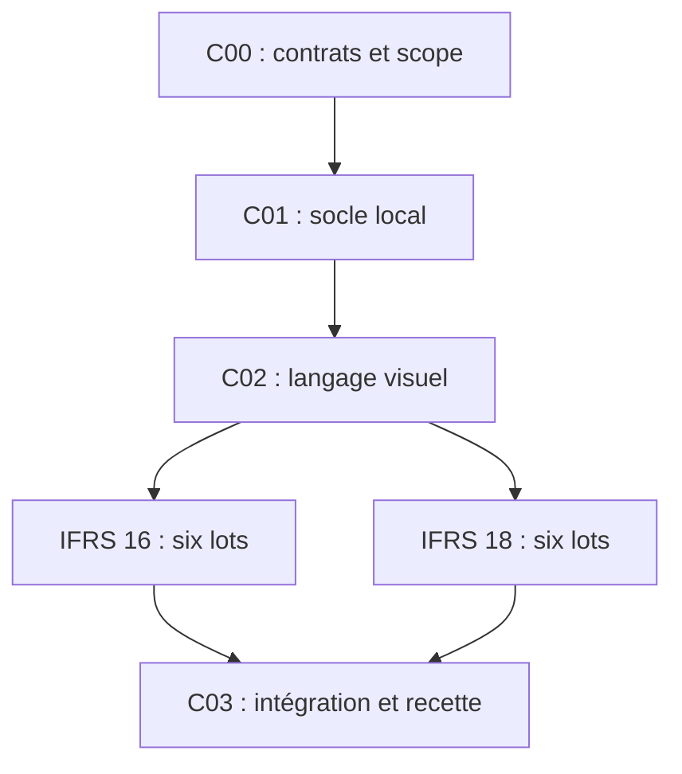

# PROBANT — Plan d’architecture et prompts IFRS 16 / IFRS 18

Version 1.0 — 16 octobre 2026. Livrable de conception : aucune fonctionnalité n’est déclarée construite ou testée par ce dossier.

## Résultat visé

Créer deux ateliers locaux, cohérents avec PROBANT : **Locations IFRS 16** pour qualifier, recalculer et justifier des locations simples côté preneur ; **Présentation IFRS 18** pour classer des données déjà préparées en IFRS, organiser le résultat, expliquer les comparatifs et documenter les mesures de performance définies par la direction (MPM).

Ce n’est ni un ERP, ni un convertisseur universel de FEC en comptes IFRS, ni un logiciel de consolidation. Le moteur IFRS 16 ne remplace pas les autres retraitements nécessaires pour préparer une base IFRS complète. L’atelier IFRS 18 ne valide pas cette préparation.

## Contenu du dossier

| Document | Usage |
|---|---|
| [Architecture et scope](01_ARCHITECTURE_ET_SCOPE.md) | Contrats de données, responsabilités, limites et intégration |
| [Charte UI et datavisualisation](02_CHARTE_UI_ET_DATAVIZ.md) | Disposition, couleurs, interactions, graphiques et recette visuelle |
| [Sources et matrice normative](03_SOURCES_ET_MATRICE_NORMATIVE.md) | Références à vérifier avant de rendre une règle exécutable |
| `COMMUN/` | Quatre prompts communs, dont un lot final d’intégration |
| `IFRS16/` | Six prompts spécifiques aux locations |
| `IFRS18/` | Six prompts spécifiques à la présentation |

Chaque fichier de prompt contient une mission directement utilisable. Les documents communs doivent être joints ou accessibles à l’agent ; le nom d’un fichier dans une conversation ne suffit pas à lui donner accès à son contenu.

## Ordre d’exécution obligatoire

| Ordre | Prompt | Dépendance | Porte de sortie |
|---|---|---|---|
| 1 | [C00 — Base et contrats](COMMUN/C00_BASE_ET_CONTRATS.md) | Les quatre documents racine | Scope, sources, interfaces et inventaire validables ; pas de code applicatif |
| 2 | [C01 — Socle IFRS local](COMMUN/C01_SOCLE_IFRS_LOCAL.md) | C00 | Persistance et contrats communs testés |
| 3 | [C02 — Composants et navigation](COMMUN/C02_COMPOSANTS_ET_NAVIGATION.md) | C01 | Shell graphique réel, sans résultats fictifs |
| 4–9 | L16-01 → L16-06, dans `IFRS16/` | C02 puis lot précédent | Qualification → calcul → journal → interface → revue → recette |
| 10–15 | P18-01 → P18-06, dans `IFRS18/` | C02 puis lot précédent | Imports → classement → MPM → transition → interface → recette |
| 16 | [C03 — Intégration finale](COMMUN/C03_INTEGRATION_ET_NON_REGRESSION.md) | L16-06 et P18-06 | Parcours croisé et non-régression vérifiés |

IFRS 18 peut être développé sans attendre le moteur IFRS 16 si des données IFRS qualifiées sont fournies. L’ordre ci-dessus est néanmoins recommandé pour un développeur ou agent unique. Ne pas ouvrir simultanément des lots qui modifient `WorkpaperService`, les migrations ou le registre des capacités. Aucun parallélisme entre agents n’est requis par ce dossier.

## Mode d’emploi d’un prompt

1. Copier le dossier documentaire dans un emplacement de travail accessible, par exemple `docs/ifrs-plan/`. Ce chemin est proposé ; il n’existe pas encore dans le dépôt audité.
2. Donner à l’agent le prompt courant et les quatre documents racine. Exiger la lecture du handoff du lot précédent.
3. Exécuter un seul lot. Un lot terminé produit un diff local, ses tests, des captures si l’UI est touchée et un handoff.
4. Ne passer au suivant que si les critères de sortie sont satisfaits. Un test ignoré ou une source inaccessible doit être déclaré comme non vérifié.
5. Faire une revue avant fusion. **Ces prompts n’autorisent ni push, ni PR distante, ni fusion, ni déploiement, ni migration de la base personnelle réelle.** Les migrations sont vérifiées sur une base locale jetable ; leur application aux données personnelles exige une demande ultérieure explicite et une sauvegarde adaptée.

## Convention de livraison de chaque lot

Produire dans le dépôt, pendant la future implémentation, `docs/ifrs/handoffs/<ID>.md` avec : SHA de départ et d’arrivée locale ; fichiers modifiés ; avant/après et cause ; sources effectivement lues ; contrats changés ; migrations ; commandes et résultats ; cas non vérifiés ; captures ; limitations ; dépendances et prochain lot. Le handoff n’est pas une preuve de test en lui-même : joindre les résultats pertinents.

Toute décision de scope suit le même vocabulaire : `couvert`, `manuel_documenté`, `bloqué`, `hors_périmètre`. Une détection d’un cas exclu ne vaut pas traitement comptable de ce cas.

## Base du dossier

GitHub `ludoviclabs-dotcom/PROBANT`, branche `main`, SHA `e25a4adfe82aaf2249b4011603f1846beea7b970` ; production Vercel `READY`, déploiement `dpl_29yg3MMYrHwNMkYD69jjyecEFjJA`, même SHA, observés le 16/10/2026. Lecture des métadonnées des PR #75 à #97 et inspection ciblée du code ; ce n’est pas une nouvelle recette de l’ensemble du produit. Aucun test applicatif du dépôt n’a été relancé pour rédiger ce plan.

Le guide joint sert à la pédagogie et à la continuité du projet, pas à transformer ses exemples en paramètres normatifs. Les références publiques et leurs limites d’accès sont documentées dans le registre des sources.

## Définition de « terminé » pour l’ensemble

Deux ateliers opérationnels sur le profil local, recettes indépendantes, provenance jusqu’à la ligne source, exports reproductibles, invalidation ciblée après changement, interfaces contrôlées à 390/1024/1440 px. Aucun badge global « conforme IFRS » : le périmètre réalisé et les limites restent visibles. Aucune garantie irréaliste de zéro bug ; les erreurs connues, cas non couverts et contrôles réalisés sont explicités.
