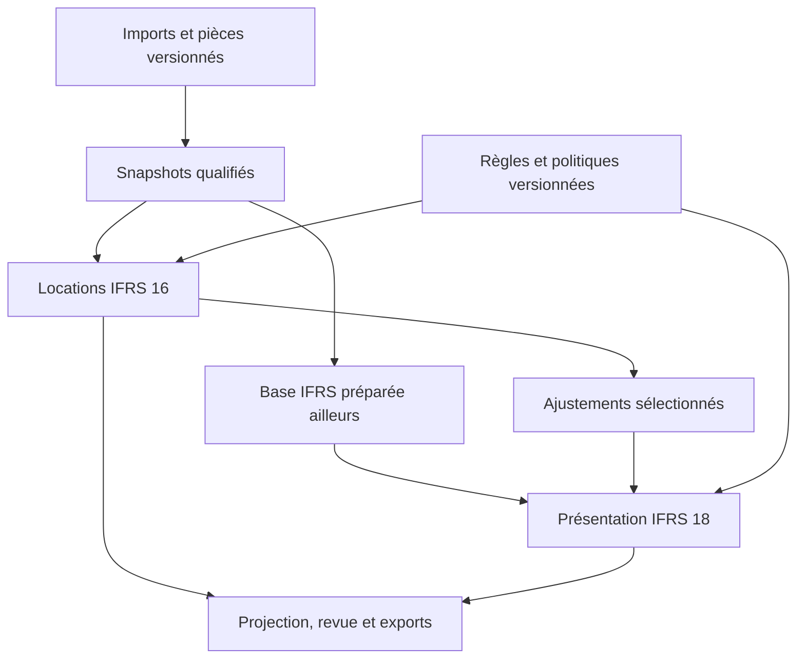

# Architecture cible et contrat de périmètre

Version 1.0 — 16 octobre 2026. Les noms de types et routes IFRS ci-dessous sont **des propositions à implémenter**, pas des capacités déjà présentes.

## 1. Décisions structurantes

- Usage personnel self-host sur le PC : Next.js/TypeScript existant, PostgreSQL local, pièces sur disque. Vercel reste une vitrine de scénarios synthétiques ; aucune connexion du site public à la base du PC n’est prévue.
- Unité de travail : entité, dossier, exercice, période, référentiel et version. Les modes historique, scénario et local persistant ne sont pas interchangeables.
- Conserver la base PCG. Les ajustements IFRS sont une couche séparée, avec portée et motif. **Retraitement de référentiel ≠ anomalie d’audit ≠ correction comptabilisée.**
- Pas de calcul comptable faisant autorité dans React, dans un graphique ou dans un export. Les trois lisent une projection serveur canonique.
- L’atelier IFRS 18 accepte une base déclarée et rapprochée IFRS ; il ne transforme pas automatiquement une base PCG en IFRS.
- Réutiliser les mécanismes existants avant d’ajouter un stockage, un ordonnanceur ou une bibliothèque. Ne pas faire un second `WorkpaperService` pour éviter ses extensions nécessaires.

## 2. Ancrage réel dans le dépôt

| Existant inspecté | Réutilisation attendue | Ce qu’il ne faut pas en déduire |
|---|---|---|
| `lib/workpapers/service.ts`, `model.ts`, `calculations.ts` | Exécution, révisions, populations, revue, verrouillage | Aucun adaptateur IFRS actuellement enregistré |
| `lib/canonical-model/money.ts`, `period.ts` | Montants EUR sérialisés, centimes `bigint`, dates civiles | Une actualisation ne se résume pas à un calcul en centimes entiers sans précision intermédiaire |
| `lib/workpapers/loan-*` ; PR #95 | Conventions de source, contrats, échéances, preuves | Le moteur Emprunts exclut le crédit-bail ; ce n’est pas un moteur IFRS 16 |
| `lib/workpapers/fixed-asset-*` ; PR #82 | Principes de base restante, cumul et fin de plan | Ne pas dupliquer son moteur PCG ni écraser son registre avec les ROU IFRS |
| `lib/workpapers/closing-*` ; PR #96–97 | Rattachement exact, fraîcheur, projections et décisions | Ne pas additionner les retraitements normaux aux expositions d’anomalies C05 |
| `lib/capabilities/registry.ts` | Publication précise des capacités/modes | Une route ou un drapeau activé n’atteste pas une exécution |
| `lib/ingestion/local-runtime.ts`, stockage local et imports | Traitement local, reprise, empreintes, approbation d’import | La file d’ingestion ne doit pas être réaffectée aveuglément aux calculs IFRS |
| `app/globals.css`, Recharts, TanStack Table, composants de synthèse accessibles | Tokens et représentations accessibles | Aucune refonte globale ou nouvelle bibliothèque graphique par défaut |
| `data/cycles/contrats-location-ifrs16.yml`, crosswalk PCG–IFRS | Point d’entrée pédagogique, contenu à requalifier | Le YAML documentaire n’est ni une règle revue ni une preuve d’exhaustivité |

## 3. Architecture logique

Le chemin D → F n’est autorisé que si le manifeste de E déclare que ces ajustements ne sont pas déjà inclus. Une base IFRS incluant déjà IFRS 16 ne reçoit pas une seconde fois le bundle. Une base PCG + un seul bundle IFRS 16 reste une base partiellement retraitée tant que les autres retraitements nécessaires ne sont pas qualifiés.

Organisation proposée : `lib/ifrs/shared/`, `lib/ifrs/leases/`, `lib/ifrs/presentation/`, avec adaptateurs ciblés sous `lib/workpapers/` et composants sous `components/probant/ifrs/`. Les routes proposées sont `/ifrs/locations` et `/ifrs/presentation`, avec variantes synthétiques explicites. C00 doit confirmer ces chemins et les interfaces sur le code alors courant.

## 4. Contrats de données communs

| Contrat proposé | Champs et invariants minimaux |
|---|---|
| `IfrsContext` | Identifiants de scope existants, entité canonique, exercice/période, devise EUR, juridiction `IASB` ou `EU_adopted`, édition et empreinte normative, date de première application, mode réel/scénario |
| `SourceSnapshot` | Versions des documents/imports, approbation, schéma de mapping, lignes sources, population et empreinte ; type de base `PCG`, `IFRS_prepared` ou `partial_bridge` |
| `PreparationManifest` | Référentiel de mesure déclaré, contrôles de cadrage, auteur/date, exclusions et ajustements déjà inclus ; ne certifie pas l’ensemble des IFRS |
| `RulePack` | Norme, paragraphes, sources primaires, dates d’effet, juridiction, statut de revue, version du moteur, politiques internes séparées ; jamais une date unique remplaçant une édition |
| `AdjustmentBundle` | ID logique stable, version, scope, run et empreinte exacts, base attendue, identifiants économiques dédupliqués, lignes débit/crédit équilibrées, statut, taxStatus et preuve ; type V1 `closing_adjustment`, distinct du détail économique des mouvements ; aucune écriture dans le FEC source |
| `PresentationDataset` | Lignes de résultat signées, identités uniques, périodes N/N-1, dimensions de nature, anciennes rubriques IAS 1, classification IFRS 18 et allocations approuvées ; valeurs et présentation séparées |
| `CanonicalProjection` | Montants déterminés/indéterminés, exceptions, couverture, détails et dénominateurs, empreintes d’entrée/règles/mapping/bundles ; alimentant table, graphiques, revue et export |

`Money` et `KnownAmount` existants restent les frontières monétaires. Pour les facteurs d’actualisation, utiliser une arithmétique décimale déterministe à précision documentée, choisie après inspection des dépendances. Interdit : addition comptable en `number`, JSON sérialisant directement un `bigint`, conversion silencieuse d’une chaîne vide en zéro.

### Signes, périodes et agrégations

- Journal : débit et crédit positifs dans deux champs exclusifs ; équilibre exact en centimes.
- Résultat IFRS 18 : produit positif, charge négative. L’adaptateur conserve la convention brute et la règle de conversion ; ce n’est pas une règle fondée sur le seul préfixe du compte.
- Dette locative : encours positif. Distinguer principal, intérêts, paiements et flux non actualisés.
- Une ligne et chaque fraction allouée sont comptées une fois. Les montants signés ne servent pas seuls à mesurer l’exhaustivité : exposer aussi nombres de lignes et sommes absolues, avec périmètre et méthode.
- Comparaison interdite entre périodes, devises, entités ou bases de mesure incompatibles. Un filtre d’écran ne modifie pas la population de revue.

## 5. IFRS 16 — périmètre V1 fermé

### Couvert automatiquement après qualification

Une entité, EUR, preneur, modèle du coût, composante locative déjà isolée et documentée ; paiements mensuels fixes à terme échu ; commencement le premier jour d’un mois et échéances en fin de mois ; clôture en fin de mois ; durée entière de 1 à 120 mois. La borne 120 mois est une limite technique interne, pas normative. Durée retenue, utilité du ROU et taux sont approuvés. Pas de transfert de propriété ni option d’achat. Amortissement linéaire retenu et justifié sur la durée la plus courte pertinente, en mois entiers, sans valeur résiduelle pour ce périmètre.

Les flux locatifs du modèle excluent la TVA entièrement récupérable, ou portent sur une opération explicitement sans TVA. Ce traitement est documenté, jamais supposé. Si les règlements sont TTC, le cadrage conserve séparément loyer retenu, TVA qualifiée et règlement total, sans confondre ces bases. TVA non récupérable ou récupération incertaine : hors calcul automatique V1 ; pas de décision fiscale implicite.

Contrats nouveaux et suivi des contrats déjà calculés dans PROBANT. Un contrat historique inchangé peut être recalculé depuis son origine si toutes les données sont présentes et si son ouverture est rapprochée à un reporting IFRS validé ; sinon diagnostic seulement. Aucune méthode de première adoption IFRS 1/transition IFRS 16 n’est choisie par l’outil.

Le taux contractuel utilisé doit être sourcé : taux implicite facilement déterminable ou, sinon, taux d’emprunt marginal approuvé. Stocker la nature du taux et son unité. Convention V1 proposée : taux annuel effectif décimal `r`, taux mensuel `(1+r)^(1/12)-1`. Si la source fournit un taux nominal, il faut une conversion préalablement documentée/validée ; ne pas le traiter automatiquement comme effectif. Zéro documenté autorisé ; taux négatif hors V1 avec motif.

### Manuel documenté

Qualification du contrôle de l’usage et de l’actif identifié, durée et options, justification du taux, élections d’exemption et revue des sources. Les exemptions court terme/faible valeur ne se déclenchent pas sur un montant universel ; aucune valeur de 5 000 ni aucun taux de 5 % n’est une règle par défaut.

### Bloquant pour le calcul V1

Indexation, loyers variables, paiement anticipé, avantage incitatif, coûts directs initiaux ou remise en état non nuls ; composantes de service non séparées ; dépôt non qualifié ; garantie de valeur résiduelle ; achat/transfert de propriété ; changement de durée, modification ou résiliation ; impayé/échéancier non respecté pour les échéances déjà exigibles à la date de revue ; dépréciation ou réévaluation affectant le ROU ; capitalisation des intérêts/amortissements dans un autre actif ; autre devise ou dates hors convention. Un champ absent ne prouve pas l’absence de ces composantes.

Les échéances futures non encore exigibles ne sont pas des paiements manquants : elles alimentent le plan contractuel sans exiger une preuve de règlement anticipé. Une prise d’effet postérieure à la clôture demeure un contrat à suivre, hors reconnaissance calculée à cette date. Distinguer correction d’une donnée initialement mal transcrite et modification économique effective en cours de bail : une nouvelle version documentaire ne permet pas de réécrire l’historique pour contourner une modification hors V1.

### Restitution

Dette et ROU, intérêts/amortissement, échéancier et ponts ; écritures de retraitement proposées et cadrées. Ventilation de principal exigible à 12 mois affichée comme aide d’analyse : pas de conclusion automatique sur le classement courant/non courant. Échéances de cash non actualisées séparées de cette ventilation. Informations chiffrées pour préparer une annexe, pas une annexe IFRS 16 exhaustive. Pas de calcul IAS 12 : effet fiscal non déterminé tant qu’il n’est pas documenté hors moteur.

## 6. IFRS 18 — périmètre V1 fermé

Atelier du **compte de résultat annuel**, de sa transition depuis IAS 1 et des MPM. Une entité non financière, EUR, exercices calendaires, sans activité principale d’investissement dans les actifs visés ni de financement de clients, sans consolidation/NCI. Ce profil résulte de questions explicites documentées ; « industrie » ou « non-banque » ne suffit pas.

Entrée : données IFRS déjà reconnues/mesurées, approuvées pour ce travail et rapprochées au résultat de référence. Données comparatives cohérentes. Premier cas de recette : 2027 et comparatif 2026 ; première application antérieure à 2027 autorisée uniquement comme scénario dans V1. Pas d’automatisation des exceptions sectorielles.

Cinq catégories dans le modèle : exploitation, investissement, financement, impôts sur le résultat, activités abandonnées. Le moteur V1 ne traite pas les activités abandonnées non nulles : conserver l’énumération et bloquer ce cas, plutôt qu’omettre la catégorie. Présentation des charges par nature uniquement, politique justifiée ; pas d’état par fonction ni mixte. Aucun montant OCI traité comme charge/produit de résultat.

Classement par nature économique et source ; propositions de mapping revues ; catégories et rubriques distinctes ; ventilation explicite des lignes mixtes, sans compensation arbitraire. Dérivés/couvertures, différences de change complexes/non attribuables et cas IAS 29 non pris en charge. Un résultat de cession d’immobilisation d’exploitation n’est pas classé « investissement » au seul motif qu’il s’agit d’une cession.

MPM : inventaire des communications publiques fournies localement, qualification, rapprochement au total/sous-total IFRS le plus directement comparable, effets fiscaux importés et justifiés par élément, changements et comparatifs. Mesure interne seule ≠ automatiquement MPM ; ratio/cash-flow ≠ sous-total de produits/charges. Absence de MPM à conclure sur une population documentée ; « aucun fichier importé » n’est pas « aucune MPM ».

Hors périmètre : comptes IFRS complets, bilan/OCI/tableau des flux/variation des capitaux propres, IAS 34, ESEF/XBRL, calcul des impôts et des intérêts minoritaires, opinion ou certification. Les catégories de résultat IFRS 18 ne sont pas un mapping automatique des flux IAS 7. Pas d’EBITDA « officiel » généré sur le seul libellé.

## 7. Versions, exécution et orchestration

Réutiliser les états de feuille existants. Ajouter des états de sous-objet seulement si nécessaire ; ne pas les confondre avec `draft/ready/executed/awaiting_review/approved/locked`. Exécution, résultat de contrôle, conclusion humaine et relecture demeurent quatre dimensions.

Chaque commande sensible porte version attendue et clé d’idempotence. L’identité est celle du profil local existant, pas un rôle envoyé par le navigateur. Un calcul conserve ses entrées exactes. Un changement de contrat périme son calcul, son bundle et les présentations qui l’utilisent ; un changement de mapping P18 périme la présentation, pas le calcul L16. La consultation d’un scénario ne périme pas une version approuvée. Le remplacement d’une source ne supprime jamais les anciennes preuves.

Pour les travaux longs : adaptation locale étroite de l’ordonnancement existant, jobs persistés et reprenables, traitement par lots, checkpoints et publication atomique de la projection finale. Aucun état `completed` pour un calcul partiellement écrit ; progression opérationnelle distincte de la couverture métier.

## 8. Intégration et exports

Ajouter deux capacités précises au registre, sans annoncer « IFRS complet ». Rattachement explicite des feuilles au dossier de clôture via les conventions C14. La section IFRS est séparée des anomalies et des effets C05. Le rattachement n’accorde pas une opinion et ne recalcule pas un moteur lors de l’affichage.

Exports V1 : JSON canonique, CSV des tables, rapport HTML imprimable avec manifeste et limites. Pas de génération PDF native supplémentaire dans ces lots ; l’impression du HTML par l’utilisateur reste possible, sans annoncer un PDF déjà livré. Pièces binaires hors paquet par défaut, références vérifiables conservées. Une sélection de revue n’est pas appelée « comptabilisé ». Un export diagnostic est distinct d’un export revu, et cite les versions obsolètes s’il les montre.

### Contrat d’actions à confirmer en C00

Réutiliser les conventions HTTP existantes, avec les opérations suivantes : lire workspace/détails paginés ; qualifier et sauvegarder un objet ; figer une population ; exécuter ou consulter un job ; proposer/revoir un mapping ; sélectionner une version de bundle ; soumettre/revoir/verrouiller ; exporter un snapshot. Les commandes portent scope, ID, version attendue et clé d’idempotence ; l’identité vient du runtime existant. Une lecture n’a pas d’effet métier caché. Une opération impossible explique les prérequis manquants.

Documenter corps/réponse et codes cohérents avec le dépôt : données invalides ou incomplètes, conflit de version/source, capacité indisponible et erreur technique distingués. Le contrat n’impose pas de remplacer les endpoints existants : C00 tranche les adaptateurs exacts, C01 teste leur comportement. L’export porte version/empreinte attendue ; il n’assemble pas une partie de deux exécutions.

### Extensions explicitement non réalisées

Simulation paramétrique interactive, Sankey complémentaire, 3D, PDF natif, OCR/IA d’extraction de contrats et connecteurs ERP : hors livraison V1. Les comparaisons de versions déjà exécutées sont incluses. Une demande ultérieure d’extension doit ouvrir un lot distinct avec périmètre et recette, pas être absorbée silencieusement par le lot UI.

## 9. Performances et critères de qualité

Jeux de charge proposés : L16, 1 000 contrats × 120 mensualités ; P18, 250 000 lignes normalisées sur N/N-1, puis essai facultatif à 1 million de lignes. Ce sont des objectifs de recette, pas des capacités acquises.

Sur une machine de référence documentée : mesurer import, calcul froid/chaud, recalcul ciblé, mémoire résidente du processus, requêtes et taille des exports. Objectifs UX proposés : accusé de prise en charge < 300 ms hors gros transfert, filtres après chargement des agrégats < 200 ms au 95e percentile, lots > 2 s avec progression ; fixer le budget du calcul complet après benchmark initial, pas de promesse arbitraire. Ne pas charger 250 000 lignes dans React ni dessiner un nœud de graphe par écriture. Tester abandon, reprise et absence de double publication.
